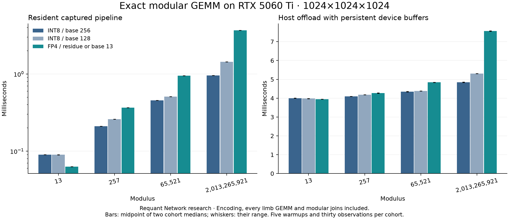

# Exact Tensor Core Arithmetic

A research project by [Requant Network](https://requant.network).

**Status: the bounded arithmetic and performance experiments are complete.** Two input cohorts cover 128 measured cases and 40,370,176 exactly checked output entries. See [results](RESULTS.md), [methods](METHODS.md) and [final conclusions](FINAL_REPORT.md).

This study asks whether a consumer Blackwell GPU can use FP4 Tensor Cores for **exact modular matrix multiplication** after lossless signed decomposition. The target is reproducible GPU mathematics for cryptographic and mining-adjacent workloads. These experiments do not measure a complete mining algorithm, profitability, proof-system throughput, or energy efficiency.

## What has actually run

| Experiment | Observed result |
|---|---|
| Independent arbitrary-precision CPU checks | 405,504 signed encodings; 36 exact modular products |
| Native SM120 FP4 and INT8 preflight | 49,152 known output entries per path, all exact |
| Complete GPU modular GEMM | SIMT, INT8 base 128/256 and FP4 agree with an independent CPU oracle at four shapes and four moduli, in two input cohorts |
| Unsafe FP4 accumulation | A deliberately large dot product loses an integer unit; retained as a measured precision failure |
| Unsafe INT8 accumulation | A deliberately excessive sum overflows signed INT32; all 16,384 affected outputs retained in the failure count |
| Chunked recovery | Both deliberately unsafe cases become exact after bounded accumulation and modular combination |

The final timing campaigns start after heavy CUDA compilation ends and run GPU jobs sequentially. Earlier correctness-only records carry no comparative performance claim. Source and native binary hashes bind the executed records.

## Main result

At modulus 13, a congruent one-digit FP4 encoding makes base-13 carries unnecessary. The 1024³ resident captured pipeline takes 0.06296–0.06309 ms across the two input-cohort medians, versus 0.08974–0.09005 ms for the faster corresponding INT8 encoding: about 1.43× faster. Including host transfers and output allocation raises the complete offload to roughly four milliseconds and largely removes that advantage.

For moduli 257, 65521 and 2013265921, the tested INT8 base-256 pipeline wins at 1024³. The wider-field FP4 construction needs more digit-pair GEMMs and modular joins. These results favor different encodings for native tiny fields and wider fields; no general FP4 speedup is inferred.



## Arithmetic construction

The independent oracle uses Python integers for small cases. The larger comparison uses float64 integer GEMMs on unsigned 16-bit planes, with `K * 65535^2 < 2^53`: one product for fields up to 16 bits and four for the wider field. Every partial is reduced modulo the field before weighted recombination. This oracle is checked against arbitrary-precision multiplication first. A plain INT64 matrix multiply would overflow for the widest field and is not used as the reference.

For INT8, centered field elements are decomposed in balanced base 128 or 256. Each limb product uses native cuBLAS integer GEMM. The sufficient bound `K * max_digit^2 < 2^31` is checked before execution.

For FP4, balanced base 13 uses residues represented by `(0, 1, 2, 3, 4, -8, 6, -6, 8, -4, -3, -2, -1)`. Every digit divided by two is exactly representable in E2M1. Fixed block scales equal one, and FP32 output with epilogue scale four restores integer limb products. A conservative sufficient bound `K * 64 < 2^24` is enforced. For modulus 13 itself, one congruent digit suffices; wider fields retain the full integer expansion. This is exact bounded arithmetic, rather than approximate inference quantization.

The GPU path performs conversion, every pair of limb GEMMs, modular reduction, and weighted recombination. Results are compared entry by entry with no tolerance. Different bases change the number of limb GEMMs; FP4 instruction throughput alone cannot establish a full-pipeline advantage.

## Reproduction

Run CPU controls with Python 3.12:

```sh
python cpu_study.py
python verify_records.py
```

GPU experiments require an RTX 5060 Ti / SM120, CUDA 13.3, cuBLAS, NumPy 2.2.6 and CuPy 13.6.0. Clone NVIDIA CUTLASS at `b2f249acd20392beeb16f5e5a31f4f1a4e38b3bd`. The bridge derives its SM120 configuration from NVIDIA's BSD-licensed example; its notice remains in [cuda/fp4_bridge.cu](cuda/fp4_bridge.cu).

```sh
mkdir -p build
nvcc -O3 -std=c++17 -arch=sm_120a --expt-relaxed-constexpr -shared -Xcompiler=-fPIC \
  -I../cutlass/include -I../cutlass/tools/util/include cuda/fp4_bridge.cu -lcublas -o build/libexact.so
python gpu_preflight.py
python gpu_study.py --validation-only --output results/gpu-validation.json
python precision_controls.py
```

To reproduce the final timing campaign, omit `--validation-only`, use output `results/gpu-study-20261109.json`, and repeat with seed `20261209` and output `results/gpu-study-20261209.json`. Five warmups and thirty observations are retained separately for direct resident, captured and transfer-inclusive execution. Conversion and reduction are inside resident timers; device allocation/planning is separate. Transfer-inclusive timing includes host output allocation. Global library/context initialization and initial persistent input/output allocation are outside the per-mode setup timer. Run timing campaigns sequentially, with other GPU work and heavy CPU compilation stopped.

```sh
python summarize_results.py
python generate_report.py
python verify_records.py
```

## Evidence and remaining questions

The [research protocol](RESEARCH.md) defines all five required experiments. Raw records live in [results](results). [gpu_study.py](gpu_study.py) and [precision_controls.py](precision_controls.py) retain real failures instead of treating a bound as sufficient performance evidence. CPU CI verifies reference arithmetic and source bindings; it cannot re-execute SM120 kernels on hosted CPU runners.

The completed [final report](FINAL_REPORT.md) maps every protocol gate to retained evidence and prioritizes application integration, data residency and wider-field INT8 joins. [Related work](RELATED_WORK.md) distinguishes established exact-BLAS techniques from this experiment. CPU CI rechecks arithmetic, source/artifact hashes and deterministic table/report generation. Native CUDA execution remains a separately recorded GPU experiment. No energy or mining-income claim is made. Original code is [MIT licensed](LICENSE); NVIDIA-derived code retains its BSD terms.
