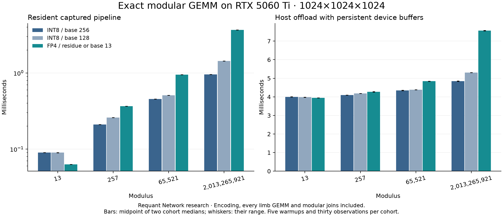

# Results

A research project by [Requant Network](https://requant.network).

## Completed workload

Two independent input cohorts contain 32 matrix pairs across four shapes and four moduli. Four implementations produce 128 measured cases and 40,370,176 exactly checked output entries. Every resident direct, captured and transfer-inclusive case retains five warmups/thirty observations. The CPU oracle is timed once per matrix pair; its samples are shared by the four corresponding mode records.

All outputs match the independent integer oracle without tolerance. All 128 captured paths also have their output checked before graph timing. The CPU controls retain 405,504 signed-encoding checks, 36 modular products and 2,000 additional native-modulus residue checks. These are execution counts, not independent random-model populations.

## Full pipeline at 1024×1024×1024

Each interval below spans the two input-cohort medians. It is not a confidence interval. Resident graph time includes device encoding, all limb products and modular joins. Transfer-inclusive time additionally includes H2D input, D2H output and host output allocation, with persistent device buffers. Setup/planning is separate in the full CSV.

| Modulus | Path | Resident graph median, ms | Transfer-inclusive median, ms |
|---|---|---:|---:|
| 13 | int8 | 0.0899–0.0901 | 4.0009–4.0033 |
| 13 | int8-base128 | 0.0897–0.0900 | 3.9764–3.9809 |
| 13 | fp4 | 0.0630–0.0631 | 3.9446–3.9525 |
| 13 | simt | 26.2719–26.2987 | 30.2233–30.2425 |
| 257 | int8 | 0.2104–0.2107 | 4.0979–4.1000 |
| 257 | int8-base128 | 0.2595–0.2597 | 4.1792–4.1798 |
| 257 | fp4 | 0.3662–0.3663 | 4.2607–4.2836 |
| 257 | simt | 26.2741–26.2906 | 30.2102–30.2441 |
| 65521 | int8 | 0.4565–0.4565 | 4.3380–4.3622 |
| 65521 | int8-base128 | 0.5075–0.5076 | 4.3839–4.3862 |
| 65521 | fp4 | 0.9467–0.9473 | 4.8390–4.8413 |
| 65521 | simt | 26.3133–26.3585 | 30.2392–30.2500 |
| 2013265921 | int8 | 0.9557–0.9558 | 4.8389–4.8553 |
| 2013265921 | int8-base128 | 1.4315–1.4325 | 5.3088–5.3107 |
| 2013265921 | fp4 | 3.6611–3.6611 | 7.5594–7.5802 |
| 2013265921 | simt | 26.6001–26.6084 | 30.5062–30.5176 |

The full per-shape, per-seed data, direct-dispatch observations, setup values, min/max and p95 summaries are in [summary.csv](results/summary.csv). Raw data are [cohort 20261109](results/gpu-study-20261109.json) and [cohort 20261209](results/gpu-study-20261209.json).

## Native dispatch evidence

An independent Nsight Systems activity capture of the unchanged two-shape preflight observes the CUTLASS SM120 block-scaled FP4 kernel and two `nvjet_sm120_bii_mma_*` integer-library kernels. Their exact names, counts, profiler version and native binary hash are retained in [dispatch-profile.json](results/dispatch-profile.json). This confirms the observed native kernel families for that preflight; it is not a separate SASS audit of every timing shape. Profiled durations are excluded from the comparative tables, and the full trace remains private because it can contain host/process paths.

## Positive and negative findings

At modulus 13, a single congruent FP4 digit replaces each input; base-13 carries vanish modulo 13. The 1024³ resident FP4 pipeline is 1.425–1.427× faster than the faster measured INT8 base for the corresponding input. That advantage is specific to this residue encoding and workload. Transfer-inclusive latency is around four milliseconds, so the saved tens of microseconds form a small fraction of the complete offload.

For moduli 257, 65521 and 2013265921, INT8 base 256 is faster than the tested FP4 limb pipeline at 1024³. FP4 needs more digit-pair products and joins. Its raw arithmetic capability therefore does not establish a wider-field pipeline win. INT8 base 128 is retained as an encoding comparator and is slower than base 256 in these 1024³ cases.

The scalar SIMT baseline is much slower in this workload. It performs a modular division at every K step and is not an optimized state-of-the-art SIMT implementation. CPU comparisons likewise refer to the documented bounded BLAS oracle, including its own temporaries and modular joins, rather than to every possible CPU finite-field library.

## Precision controls

The deliberately unsafe FP4 dot product loses an integer unit in one output. The deliberately unsafe INT8 accumulation overflows all 16,384 output entries. Bounded K chunks restore all 16,384 entries in each experiment. The raw [precision-control record](results/precision-controls.json) retains the unsafe values, expected values, failure counts and corrected output hashes. Chunking correctness is established; the large unsafe cases are not a separate chunking-throughput benchmark.

## Provenance and limits

The device is an RTX 5060 Ti, with native CUDA 13.3.73 and the recorded CuPy/NVRTC environment. GPU jobs are sequential and comparative timing starts after the heavy CUDA build ends. Clocks and power limits are unchanged. The earlier four-plane CPU comparator was corrected to omit zero upper planes before the final timing campaign; the final narrow-field oracle uses one BLAS product, and the wide field uses four.

The study covers these fields, shapes, constant scale factors and implementations. No energy, complete-miner, application-throughput or production-proof claim is made. See [Methods](METHODS.md), [related work](RELATED_WORK.md), the [final interpretation](FINAL_REPORT.md) and [environment record](results/environment.json).
